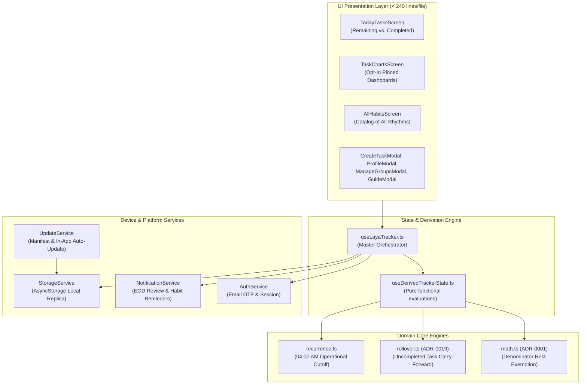
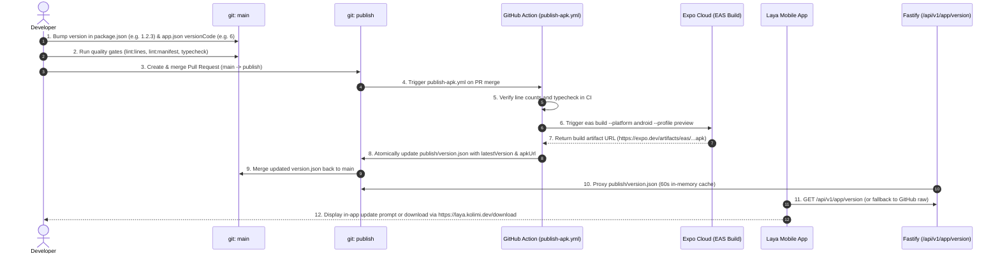

# Laya (లయ) Mobile — Personal Rhythm & Consistency App

> **Pressure-free personal consistency tracking on your own terms.**  
> React Native 0.88 • Expo 58 • TypeScript • Local-First Offline Engine • Zero-Guilt Discipline

Part of the [Kolimi Studio](https://github.com/kolimi-dev) ecosystem.  
Live Download: `https://laya.kolimi.dev/download` | Backend Gateway: `https://tracker.kolimi.dev`

---

## 1. System Architecture

Laya Mobile is a high-performance, local-first React Native application built on Expo SDK 58. It operates completely offline with instant local responsiveness, background bidirectional synchronization, and guilt-free behavioral psychology.



### Core Architectural Pillars:

#### 1. 04:00 AM Operational Day Cutoff (`getOperationalDate`)
Real-world human habits do not reset at midnight. Reading, meditating, or finishing water intake often happens between 12:00 AM and 03:30 AM.
- Rather than slicing habits by strict calendar dates, Laya anchors daily rhythm to an **operational cutoff at 04:00 AM**.
- Actions logged at `01:30 AM on Tuesday` count towards `Monday's cadence`.
- Day-advancement transitions seamlessly when active app state resumes past 04:00 AM.

#### 2. Task Rollover Engine (`src/core/rollover.ts`, ADR-0019)
- **Problem:** In traditional apps, non-daily habits (e.g. interval: 7 days, specific days `[Mon, Thu]`, monthly, or one-time tasks) vanish if not completed on their exact due date.
- **Solution:** Uncompleted tasks automatically carry forward to subsequent days until completed or rested.
- **Fixed Schedule Anchors:** Rolling a habit forward does **not** drift future recurrences; subsequent occurrences remain firmly pinned to their canonical cadence.
- **Visual Cue:** Evaluated rolled-over tasks display a subtle `🔄 Brought forward` badge in their detail drawer.

#### 3. Pure State Derivation (`useDerivedTrackerState.ts`)
- Computes `evaluatedTasks`, `remainingTasks`, `completedOrRestedTasks`, and `consistencyScore` deterministically from raw task definitions and append-only completion events.
- **Guilt-Free Denominator Exemption (ADR-0001):**
  $$\text{Consistency Rating (\%)} = \frac{\sum \text{Completed Points}}{\text{Total Scheduled Points} - \text{Ignored Points}} \times 100$$
- **Chart Deduplication:** Deduplicates `validPinnedCharts` using `${dashboardId}:${taskId}` composite keys, preventing chart clutter.

#### 4. Offline Local Notifications (`NotificationService.ts`)
- Configures dedicated Android notification channels:
  - `habit-reminders` (High Importance, lights, vibration) for individual task reminder times.
  - `eod-review` (Default Importance) for daily evening wind-down reminders.
- **End-of-Day (EOD) Evening Rhythm Review:** Automatically schedules a daily recurring reminder at the user's configured **Sleeping Time** (defaults to 8:00 PM / 20:00) with the prompt:  
  *“🌙 Evening Rhythm Review: Review today’s habits and wind down without streak guilt!”*
- Handles one-time habits, specific weekday masks (`days_of_week`), and auto-cancels alerts when habits are paused, archived, or deleted.

---

## 2. Release & Publishing Workflow (How Publishing Currently Works)

Laya Mobile uses an automated, continuous delivery pipeline utilizing GitHub Actions and Expo Application Services (EAS) to compile and publish standalone Android APKs without manual intervention or manifest race conditions (ADR-0019).



### Step-by-Step Publishing Lifecycle:

#### Step 1: Version Bump on `main`
1. Increment `"version"` in `package.json` (e.g. `"1.2.3"`).
2. Increment `"versionCode"` in `app.json` under `expo.android` (e.g. `6`).
3. Run verification checks locally:
   ```bash
   npm run lint:manifest
   npm run lint:lines
   npm run typecheck
   ```
4. Commit the change on `main`:
   ```bash
   git commit -m "chore(release): bump version to 1.2.3 (versionCode 6)"
   ```

#### Step 2: Merge Pull Request (`main` $\rightarrow$ `publish`)
- Open a Pull Request from `main` into the release branch `publish`.
- Merging this PR triggers the automated workflow `.github/workflows/publish-apk.yml`.

#### Step 3: Automated EAS Cloud Compilation & Manifest Commit
- The GitHub Action runner:
  1. Checks out the `publish` branch.
  2. Runs quality gate scripts (`npm run lint:lines` and `npm run typecheck`).
  3. Executes `eas build --platform android --profile preview --non-interactive --json`.
  4. Parses the JSON output to extract the signed APK artifact URL (`apkUrl`).
  5. Atomically modifies `version.json` on the `publish` branch using `jq`:
     ```json
     {
       "latestVersion": "1.2.3",
       "apkUrl": "https://expo.dev/artifacts/eas/...apk",
       "releaseNotes": ["..."]
     }
     ```
  6. Pushes the updated `version.json` directly to `publish` with `[skip ci]`.

#### Step 4: In-App Auto-Update Checking & Permanent Redirect
- **In-App Checking:** Mobile clients query the backend version endpoint `GET /api/v1/app/version` periodically.
  - If the backend is temporarily unreachable, `UpdateService` gracefully falls back to fetching `https://raw.githubusercontent.com/kolimi-dev/laya-mobile/publish/version.json`.
  - When `isNewerVersion(remote, local)` is `true`, an update dialog offers immediate APK download.
- **Permanent Download Link:** Users downloading the app from the web navigate to `https://laya.kolimi.dev/download` (or `GET /download` on the API), which dynamically responds with an HTTP `302 Redirect` to the exact signed APK URL from the active manifest.

---

## 3. Engineering Guardrails & Quality Gates

To preserve code maintainability and modularity, strict automated gates are enforced in CI:
1. **Strict File Line Budget (Zero Exceptions):**
   - Every `.ts` and `.tsx` file must be strictly `< 240 lines`.
   - Verified via `npm run lint:lines` (`node scripts/check-line-counts.js`).
2. **Release Manifest Integrity:**
   - `package.json` version must always be $\ge$ `version.json` (`npm run lint:manifest`).
3. **0 TypeScript Errors:**
   - Verified via `npm run typecheck` (`tsc --noEmit`).

```bash
# Run line count budget verification
npm run lint:lines

# Run release manifest consistency check
npm run lint:manifest

# Run TypeScript compilation check
npm run typecheck
```

---

## 4. License

Apache-2.0 © Kolimi Studio

